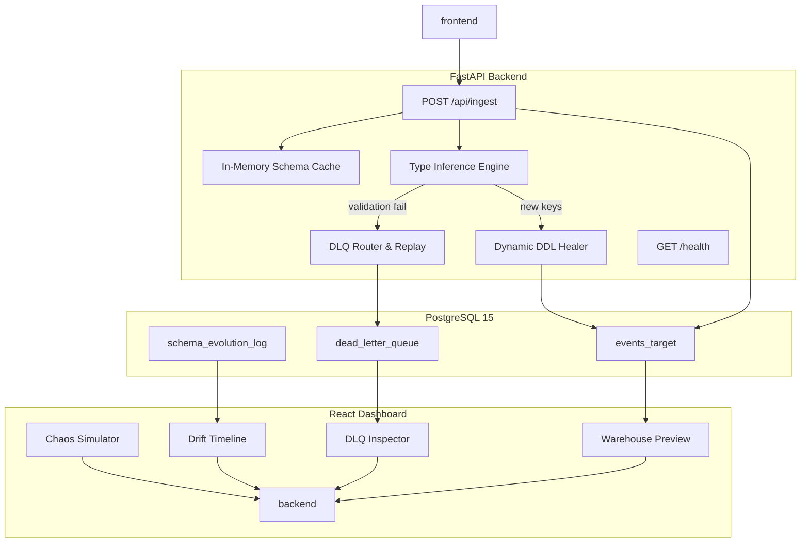

# DriftGuard – Zero‑Data‑Loss Schema Evolution Engine

<div align="center">

[](https://fastapi.tiangolo.com)
[](https://react.dev)
[](https://www.postgresql.org)
[](https://www.python.org)
[](LICENSE)

</div>

---

## 📑 Table of Contents

- [Project Overview](#project-overview)
- [Why DriftGuard? (Zero‑Data‑Loss Guarantee)](#why-driftguard)
- [The Problem & Vision](#the-problem--vision)
- [Key Features](#key-features)
- [How It Works (User Journey)](#how-it-works-user-journey)
- [System Architecture](#system-architecture)
- [Technology Stack](#technology-stack)
- [Getting Started (Local Development)](#getting-started)
- [Running the Full Stack](#running-the-full-stack)
- [API Reference](#api-reference)
- [React Demo UI](#react-demo-ui)
- [Automated Chaos Tests](#automated-chaos-tests)
- [Bonus: Automatic Type Widening](#bonus-automatic-type-widening)
- [Project Structure](#project-structure)
- [Deployment Guidelines](#deployment-guidelines)
- [Contributing](#contributing)
- [License](#license)

---

## 1. Project Overview

**DriftGuard** is a real‑time ingestion pipeline that safeguards data integrity for webhook‑driven workloads. It:
- Dynamically evolves a PostgreSQL table schema on‑the‑fly when new fields appear.
- Detects type conflicts and routes the offending payload to a **Dead‑Letter Queue (DLQ)** for later replay.
- Guarantees **Zero‑Data‑Loss** – every event is either persisted in the target table **or** stored in the DLQ.
- Provides an interactive React dashboard for visualising schema drift, inspecting the DLQ, and simulating chaotic traffic.

---

## 2. Why DriftGuard? (Zero‑Data‑Loss Guarantee)

When processing external webhooks, schema drift is inevitable – new fields appear, types change, or malformed payloads slip through. Traditional pipelines either:
- **Fail** and lose data, or
- **Silently drop** malformed rows, breaking downstream analytics.

DriftGuard enforces the invariant:

$$\\text{Target Rows} + \\text{Pending DLQ Rows} = \\text{Total Ingested Events}$$

No event disappears; the DLQ acts as a reliable quarantine with a replay mechanism, enabling **full recoverability**.

---

## The Problem & Vision

Modern APIs and third‑party services often evolve their payload schemas without notice. Conventional ingestion pipelines either crash (losing data) or quietly discard malformed rows, compromising downstream analytics. **DriftGuard flips the script** by guaranteeing that **no event is ever lost** – every payload either lands safely in the warehouse or is quarantined for later replay.

---

## Key Features

| Feature | Description |
|:---|:---|
| **Dynamic Schema Evolution** | Automatic `ALTER TABLE … ADD COLUMN` on‑the‑fly with SQL‑injection‑safe identifiers. |
| **Zero‑Data‑Loss Guarantee** | Invariant: `Target Rows + Pending DLQ Rows = Total Ingested Events`. |
| **Dead‑Letter Queue & Replay** | Irreconcilable events are stored with full payload for manual or automated replay. |
| **React Observability Dashboard** | Live drift timeline, DLQ inspector with JSON editor, and warehouse preview. |
| **Automated Chaos Tests** | Guarantees idempotency, concurrency safety, and full recovery under stress. |
| **Automatic Type Widening** | Safe promotion (e.g., `BIGINT → DOUBLE PRECISION`) when type drift is harmless. |

---

## How It Works (User Journey)

```
Incoming webhook → 4‑stage pipeline → ✅ Insert into target
                                 ↳ 🔧 Heal schema (if new fields)
                                 ↳ ❌ Route to DLQ (type conflict)
```

The pipeline ensures every event is accounted for, either persisting it or safely quarantining it for later resolution.

---

## System Architecture



---

## Technology Stack

| Layer | Tech | Reason |
|-------|------|--------|
| **Database** | PostgreSQL 15 (Docker) | Proven, supports `ALTER TABLE … ADD COLUMN IF NOT EXISTS`, JSONB, robust DDL |
| **Backend** | Python 3.11, FastAPI, Uvicorn | Async‑first, auto‑generated OpenAPI docs, excellent performance |
| **DB Drivers** | `asyncpg` (async queries) + `psycopg2‑binary` (safe DDL via `sql.Identifier`) | |
| **Frontend** | React 18 + TypeScript + Vite | Fast dev server, component‑driven UI, hot‑module reload |
| **Containerisation** | Docker + Docker‑Compose | One‑command spin‑up for the whole stack |
| **Testing** | pytest + pytest‑asyncio | Async test support, easy fixtures |
| **CI (optional)** | GitHub Actions (run `docker compose up` + pytest) | |

---

## Getting Started (Local Development)

### Prerequisites
- Docker Desktop (or Docker Engine) **≥ 20.10**
- Python 3.11 (optional for IDE work)
- Node 20 (optional for frontend development)

### Clone the repository
```bash
git clone https://github.com/your‑org/driftguard.git
cd driftguard
```

### Environment variables
Create a `.env` file at the project root (already provided) or copy the example:
```dotenv
POSTGRES_USER=driftguard
POSTGRES_PASSWORD=driftguard_secret
POSTGRES_DB=driftguard_db
POSTGRES_HOST=db
POSTGRES_PORT=5432
DATABASE_URL=postgresql://driftguard:driftguard_secret@db:5432/driftguard_db
```
> **Never commit** real passwords – `.env` is listed in `.gitignore`.

---

## Running the Full Stack

```bash
# From the project root
docker compose up -d
```
Docker Compose will spin up three containers:
- **db** – PostgreSQL 15 with the three tables created by `init.sql`
- **backend** – FastAPI service on `http://localhost:8000`
- **frontend** – React dev server on `http://localhost:5173`

### Verify health
```bash
curl http://localhost:8000/health
# → {"status":"ok"}
```
Open the React UI at `http://localhost:5173` – you should see the four‑card dashboard with the **Chaos Simulator**, **Drift Timeline**, **DLQ Inspector**, and **Warehouse Preview**.

---

## API Reference

| Method | Endpoint | Description | Success codes |
|--------|----------|-------------|---------------|
| `POST` | `/api/ingest` | Accepts any JSON webhook payload (must contain `event_id`). Runs the 4‑stage pipeline. | `201` (inserted) / `202` (DLQ) |
| `GET`  | `/api/events` | Paginated list of rows in `events_target`. | `200` |
| `GET`  | `/api/schema` | Returns current in‑memory schema cache (`{column: pg_type}`). | `200` |
| `GET`  | `/api/schema-history` | Full audit log from `schema_evolution_log` (most recent first). | `200` |
| `GET`  | `/api/dlq` | List of DLQ entries (filterable by `status`). | `200` |
| `POST` | `/api/dlq/{dlq_id}/replay` | Replay a failed event; optional patched payload in body. | `201` (replayed) / `202` (still pending) |
| `PATCH`| `/api/dlq/{dlq_id}/discard` | Mark a DLQ entry as `DISCARDED`. | `200` |
| `GET`  | `/health` | Simple health‑check endpoint. | `200` |

All endpoints return JSON; errors include a `detail` field with a human‑readable description.

---

## React Demo UI

The dashboard is split into four interactive panels:

| Panel | Purpose |
|------|---------|
| **Chaos Simulator** | One‑click buttons to send: <br>• Normal V1 event <br>• Drift V2 (adds `coupon_code`, `is_prime`) <br>• Nested V3 (`device_meta` JSON) <br>• Poison‑pill (type conflict) |
| **Drift Timeline** | Live list of `ALTER TABLE` statements from `schema_evolution_log`; highlights newly added columns |
| **DLQ Inspector** | Shows pending DLQ entries with error details, JSON editor for fixing payloads, **Replay** and **Discard** actions |
| **Warehouse Preview** | Real‑time view of `events_target` – automatically expands when new columns appear |

The UI uses **Axios** (or native `fetch`) wrappers located in `frontend/src/api.ts` for communication. CORS is enabled on the FastAPI backend.

---

## Automated Chaos Tests

Located in `backend/tests/test_chaos_drift.py` (pytest‑asyncio).

### Key test suites
1. **Idempotency & Concurrency** – 20 concurrent requests that introduce the same new column (`referral_source`). Verifies only a single `ALTER TABLE` execution and no deadlocks.
2. **Accounting Invariant** – Sends 100 payloads (valid, drifted, corrupt) and asserts:
   $$\\text{Target Rows} + \\text{Pending DLQ Rows} = 100$$
3. **DLQ Drain** – Replays all pending DLQ rows, then checks that the target table now contains all 100 rows and DLQ is empty.

Run the suite with:
```bash
docker compose exec backend pytest -s
```
Tests use fixtures that truncate the three tables before each run, guaranteeing deterministic results.

---

## Bonus: Automatic Type Widening

When a column first arrives as an integer and later receives a float, DriftGuard automatically promotes the column to a wider type (`BIGINT → DOUBLE PRECISION`).

- Safe promotions are defined in `SAFE_PROMOTIONS` inside `backend/app/schema_manager.py`.
- Promotion is logged in `schema_evolution_log` as a distinct DDL entry.
- If a promotion would widen a numeric column to `TEXT`, the payload is **routed to DLQ** to avoid downstream aggregation breakage.

---

## Project Structure

```
DriftGuard/
├─ .env                # DB credentials (git‑ignored)
├─ .gitignore
├─ docker-compose.yml
├─ init.sql            # DDL for target, audit, DLQ tables
├─ plan.md             # Implementation plan (phases, estimates)
├─ README.md           # <‑‑ you are reading this file
├─ backend/
│  ├─ Dockerfile
│  ├─ requirements.txt
│  └─ app/
│     ├─ __init__.py
│     ├─ main.py          # FastAPI entry point
│     ├─ db.py            # Asyncpg connection pool
│     ├─ schema_manager.py   # Cache + evolve_schema + promotion logic
│     ├─ type_inference.py   # Mapping & validation functions
│     └─ dlq_handler.py      # DLQ write & replay engine
│  └─ tests/
│     ├─ conftest.py
│     └─ test_chaos_drift.py
└─ frontend/
   ├─ Dockerfile
   ├─ package.json
   ├─ vite.config.ts
   └─ src/
      ├─ App.tsx               # Dashboard layout
      ├─ api.ts                # HTTP client wrappers
      └─ components/
         ├─ ChaosSimulator.tsx
         ├─ DriftTimeline.tsx
         ├─ DlqInspector.tsx
         └─ WarehousePreview.tsx
```

---

## Deployment Guidelines

1. **Production DB** – replace the local Postgres container with a managed service (e.g., CloudSQL, Amazon RDS). Update `DATABASE_URL` accordingly.
2. **TLS termination** – put a reverse proxy (NGINX, Traefik) in front of FastAPI for HTTPS and rate‑limiting.
3. **Static Frontend** – after development, run `npm run build` and serve the `dist/` folder via a CDN or a lightweight static server.
4. **Monitoring** – expose Prometheus metrics from FastAPI (`/metrics`) and forward PostgreSQL stats.
5. **Scaling** – the backend is stateless; increase `replicas` in Docker Compose or Kubernetes Deployments as needed. The schema cache lives in each replica, but all replicas share the same authoritative DB, so schema evolution remains consistent.

---

## Contributing

- Fork the repo and create a feature branch.
- Follow the existing code style (type‑hints, docstrings, Black formatting).
- Run the test suite (`docker compose exec backend pytest`) before submitting a PR.
- For UI changes, run `npm run lint` and ensure the dev server builds without errors.

---

## License

MIT © 2026 DriftGuard contributors.

---

*Built with love for Hevo Data engineers – because **no event should ever be silently dropped**.*
